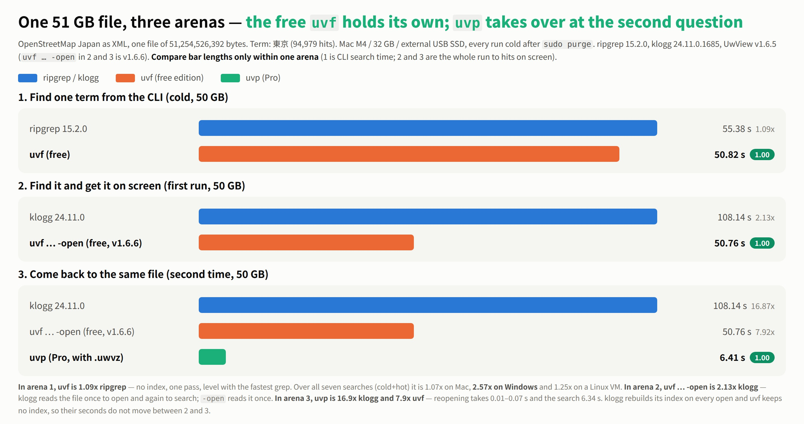
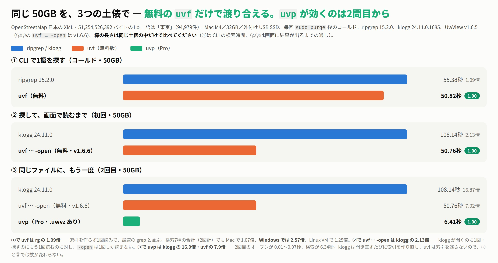

# scoop-uwview

[English](#english) · [日本語](#日本語)

## English

[Scoop](https://scoop.sh) bucket for [UwView](https://github.com/amru195704/UwView): open and search huge text/log files, with the `uvf` command.

**Current version: 1.9.1** (v1.9 “Full Spectrum”) — [release notes](https://github.com/amru195704/UwView/releases/tag/v1.9.1)

- Search many files at once: wildcards and `**` for subfolders, skipping files matched by `.gitignore` / `.ignore` (same rules as ripgrep)
- Search compressed files as they decompress: `.gz` `.bz2` `.xz` `.lzma` `.zst` `.lz4` `.br`, mixed with plain text in one run
- Read multi-file results in the viewer, with a file list and tabs
- Search the text inside Word (.docx), Excel (.xlsx) and PDF files (from v1.9)

**First time: install Scoop itself.** Run these in **PowerShell**, not Command Prompt (open "PowerShell" from the Start menu as a normal user, not as administrator; the prompt starts with `PS C:\...>`):
```powershell
Set-ExecutionPolicy -ExecutionPolicy RemoteSigned -Scope CurrentUser   # answer Y if asked
Invoke-RestMethod -Uri https://get.scoop.sh | Invoke-Expression        # installs Scoop
scoop install git                                                        # adding a bucket needs git
```
If `Set-ExecutionPolicy` is "not recognized", you are in Command Prompt. Then:

```powershell
scoop bucket add uwview https://github.com/amru195704/scoop-uwview
scoop install uwview
```

This adds a Start menu shortcut "UwView" and puts `uvf` on your PATH.

```powershell
uvf app.log 'ERROR'                  # search
uvf app.log 'ERROR' -open            # search, then show the hits in the viewer
uvf '*.log' 'ERROR'                  # several files at once (always quote the pattern)
uvf 'app.log,app.log.*.gz' 'ERROR'   # plain text and compressed files together
```



*One 51.25 GB file, three arenas. Searching one term from the command line, the free `uvf` is on par with ripgrep. Searching and then reading the hits on screen, `uvf … -open` is about 2× faster than klogg. From the second question on the same file, the paid UwView Pro (`uvp`, not installed by this package) answers in 6.41 s. Compare bars only within the same arena. Mac (Apple M4, 10 cores) / external USB SSD / OpenStreetMap XML, v1.6.6; results vary by machine. Details: [benchmarks](https://uvp.y42u.net/en/benchmarks-en/).*

Update: `scoop update uwview` · Remove: `scoop uninstall uwview`

The manifest downloads the official archive from [GitHub Releases](https://github.com/amru195704/UwView/releases) and checks its SHA256. No files are re-hosted here. The Windows build is not code-signed yet, so SmartScreen may ask on first launch (More info → Run anyway).

License of UwView: PolyForm Internal Use 1.0.0, free for personal and internal business use. See [LICENSE](https://github.com/amru195704/UwView/blob/main/LICENSE).

### UwDiff (in the same bucket)

Compare two files or two folders in any format or encoding — the sister tool [UwDiff](https://github.com/amru195704/UwDiff) is in this bucket too, with the `uvd` command. **Current version: 1.0.0 “First Light”** — [release notes](https://github.com/amru195704/UwDiff/releases/tag/v1.0.0)

- Text compared line by line with the order kept (unified diff); CSV, TSV and Excel matched by key columns, even when the row order differs
- Inside 7 compressed formats and the text of Word, Excel and PDF files; UTF-8, Shift-JIS, EUC-JP and UTF-16 detected automatically

```powershell
scoop bucket add uwview https://github.com/amru195704/scoop-uwview   # skip if already added
scoop install uwdiff
```

This adds a Start menu shortcut "UwDiff" and puts `uvd` on your PATH.

```powershell
uvd old.log new.log -o changes.diff          # text (same format as diff -u)
uvd old.csv new.csv -key ID -o diff.csv      # table, matched by the ID column
uvd old_dir new_dir -o list.csv              # folder vs folder
uvd old.log new.log -open                    # show the result in the window
```

Update: `scoop update uwdiff` · Remove: `scoop uninstall uwdiff`

License: [UwDiff License](https://github.com/amru195704/UwDiff/blob/main/LICENSE) (PolyForm Internal Use 1.0.0 plus a permission to redistribute the official binaries as packages). UwDiff is a separate product, not part of UwView.

## 日本語

[UwView](https://github.com/amru195704/UwView) の [Scoop](https://scoop.sh) bucket です。巨大なテキスト／ログファイルを開いて探すアプリと、`uvf` コマンドが入ります。

**現在の版: 1.9.1**（v1.9「Full Spectrum」） — [リリースノート](https://github.com/amru195704/UwView/releases/tag/v1.9.1)

- 複数のファイルをまとめて探せます（ワイルドカード・サブフォルダーの `**`。`.gitignore`・`.ignore` に当たるファイルは ripgrep と同じ規則で外します）
- 圧縮ファイルを展開しながら探せます（`.gz` `.bz2` `.xz` `.lzma` `.zst` `.lz4` `.br`。平文と混ぜて1回で）
- 複数ファイルの結果を画面で読めます（ファイル一覧とタブつき）
- Word（.docx）・Excel（.xlsx）・PDF の中の文字も探せます（v1.9 から）

**初めての方は、先に Scoop 本体を入れます。** コマンドプロンプトではなく **PowerShell** で実行します（スタートメニューで「PowerShell」を検索し、管理者ではない普通の権限で開く。行の頭が `PS C:\...>`）:
```powershell
Set-ExecutionPolicy -ExecutionPolicy RemoteSigned -Scope CurrentUser   # 聞かれたら Y
Invoke-RestMethod -Uri https://get.scoop.sh | Invoke-Expression        # Scoop を入れる
scoop install git                                                        # バケットの追加に git が要る
```
`Set-ExecutionPolicy` が「見つからない」と出るときは、コマンドプロンプトで打っています。続けて:

```powershell
scoop bucket add uwview https://github.com/amru195704/scoop-uwview
scoop install uwview
```

スタートメニューに「UwView」が追加され、`uvf` コマンドがそのまま使えるようになります。

```powershell
uvf app.log 'ERROR'                  # 探す
uvf app.log 'ERROR' -open            # 探して、当たりをそのまま画面で読む
uvf '*.log' 'ERROR'                  # 複数のファイルをまとめて（指定は必ず引用符で囲む）
uvf 'app.log,app.log.*.gz' 'ERROR'   # 平文と圧縮ファイルを混ぜて
```



*同じ 51.25GB のファイルを3つの土俵で。コマンドで1語を探すなら、無料の `uvf` で ripgrep と同等。探して画面で読むまでなら、`uvf … -open` が klogg の約2倍。同じファイルに戻る2回目からは、有料の UwView Pro（`uvp`・このパッケージには含まれません）が 6.41秒で答えます。棒の長さは同じ土俵の中だけで比べてください。Mac（Apple M4・10コア）・外付け USB SSD・OpenStreetMap XML・v1.6.6 での実測で、環境により異なります。詳しくは [実測まとめ](https://uvp.y42u.net/benchmarks/)。*

更新: `scoop update uwview` ／ 削除: `scoop uninstall uwview`

公式の zip を [GitHub Releases](https://github.com/amru195704/UwView/releases) から取得し、SHA256 を照合します。このリポジトリにアプリ本体は置いていません。Windows 版はまだコード署名していないため、初回起動時に SmartScreen が出ることがあります（「詳細情報」→「実行」）。

UwView のライセンス: PolyForm Internal Use 1.0.0（個人利用・企業の社内業務利用は無料）。[LICENSE](https://github.com/amru195704/UwView/blob/main/LICENSE) をご覧ください。

### UwDiff（同じ bucket）

2つのファイル・2つのフォルダを、形式や文字コードを問わず比べる姉妹ツール [UwDiff](https://github.com/amru195704/UwDiff) も、この bucket から入れられます（`uvd` コマンドつき）。**現在の版: 1.0.0「First Light」** — [リリースノート](https://github.com/amru195704/UwDiff/releases/tag/v1.0.0)

- テキストは行の並びを保って比べ（unified diff）、CSV・TSV・Excel はキー列で照合します（行の順番が違ってもよい）
- 圧縮 7 形式の中身と Word・Excel・PDF の文字も比べ、UTF-8・Shift-JIS・EUC-JP・UTF-16 を自動判定します

```powershell
scoop bucket add uwview https://github.com/amru195704/scoop-uwview   # 追加済みなら不要
scoop install uwdiff
```

スタートメニューに「UwDiff」が入り、`uvd` コマンドが PATH に入ります。

```powershell
uvd 旧.log 新.log -o 差分.diff            # テキスト（diff -u と同じ形）
uvd 旧.csv 新.csv -key ID -o 差分.csv     # 表を ID 列で照合
uvd 旧フォルダ 新フォルダ -o 一覧.csv       # フォルダどうし
uvd 旧.log 新.log -open                  # 結果を画面で見る
```

更新: `scoop update uwdiff` ／ 削除: `scoop uninstall uwdiff`

ライセンス: [UwDiff License](https://github.com/amru195704/UwDiff/blob/main/LICENSE)（PolyForm Internal Use 1.0.0 ＋ 公式バイナリのパッケージ再配布の許可）。UwDiff は UwView の一部ではなく、別の製品です。
